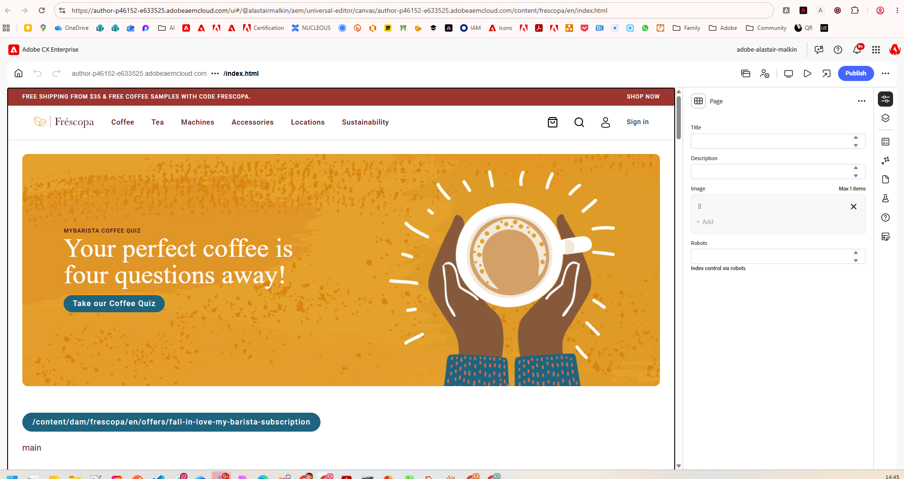

# Frescopa Site Project
Based on the boilerplate for AEM Authoring with Edge Delivery Services projects that integrate with Adobe Commerce.

## Sites

* AEM: https://author-p46152-e633525.adobeaemcloud.com/ui#/aem/sites.html/content/frescopa/en
* Preview: https://main--frescopa--amalkin.aem.page/
* Live: https://main--frescopa--amalkin.aem.live/

## Environments
- Live: https://frescopa.coffee/

## Content Setup
See <https://github.com/markszulc/frescopa-with-edge-delivery-services>

## Code Setup

See also [Developer Tutorial](https://experienceleague.adobe.com/en/docs/experience-manager-cloud-service/content/edge-delivery/wysiwyg-authoring/edge-dev-getting-started)

1. Fork this repository
2. Add the [AEM Code Sync GitHub App](https://github.com/apps/aem-code-sync) to the repository, so your code changes get synced with EDS.
4. Update the mountpoint in `fstab.yaml`
5. Update the path mappings in `paths.json`
